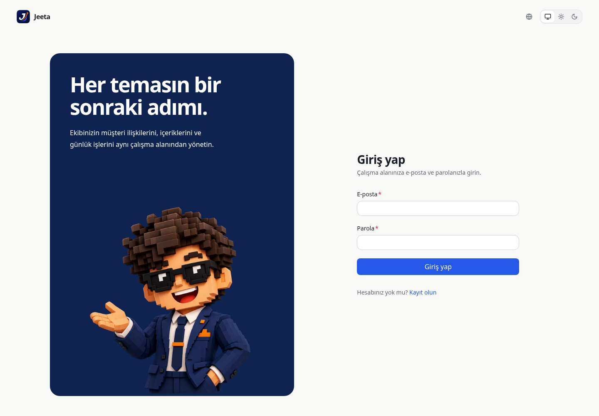
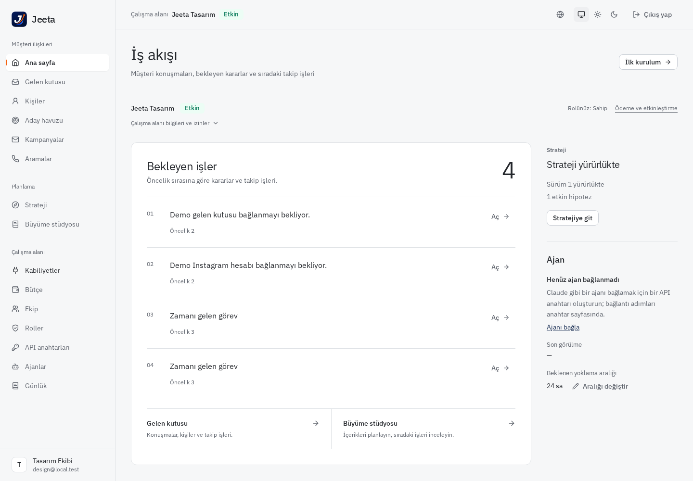
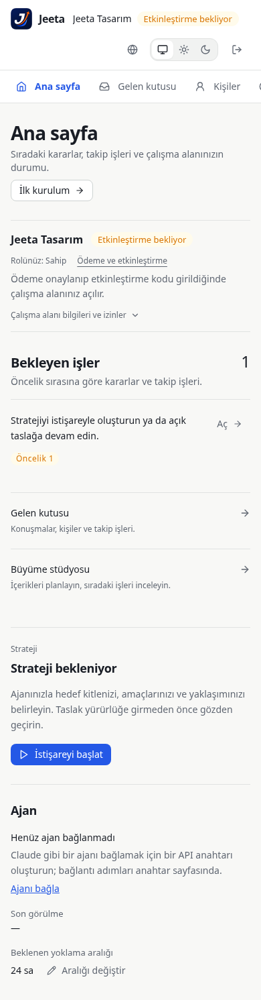
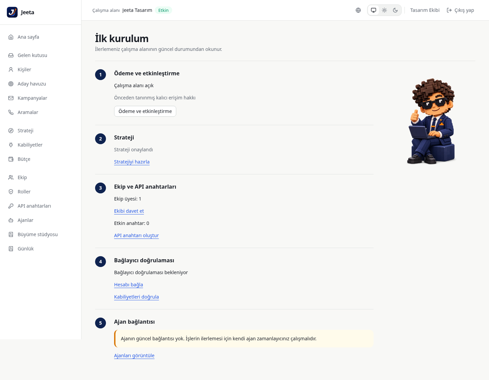
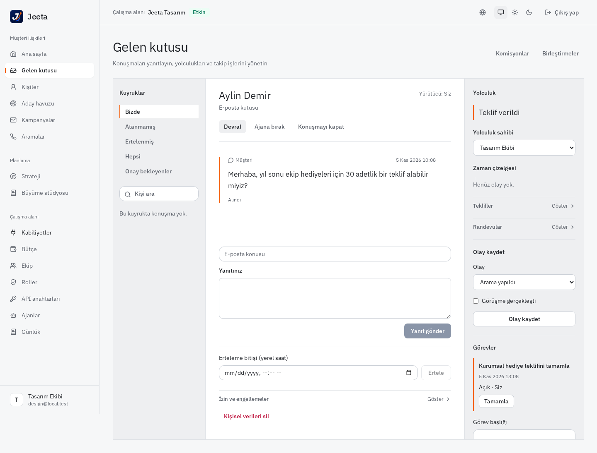
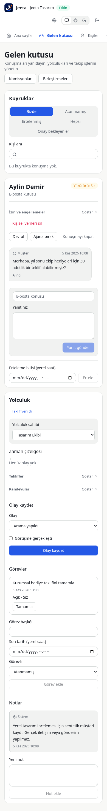
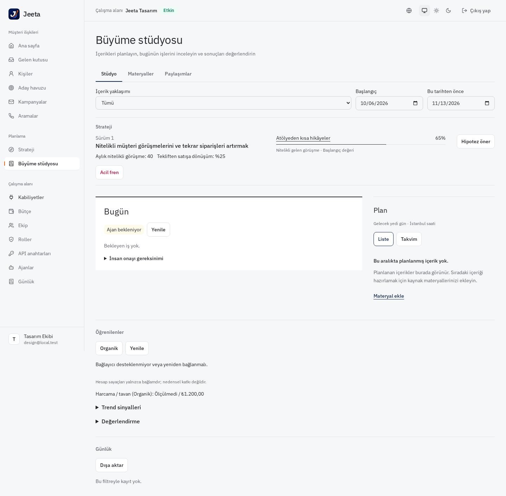
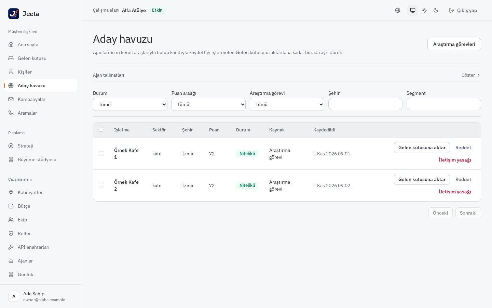
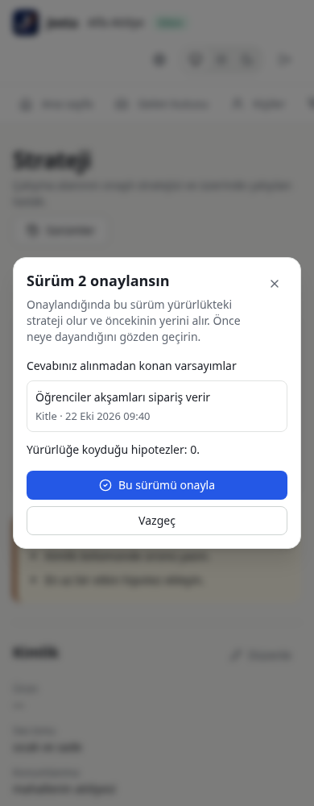
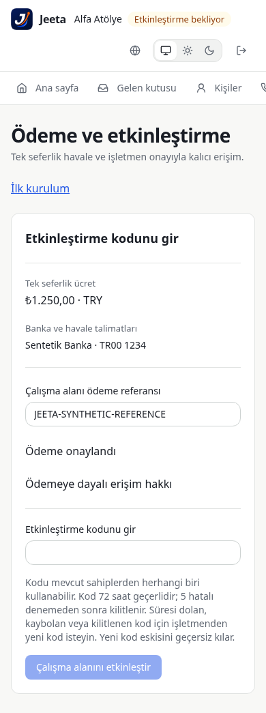

# Jeeta panel refinement

The Rust panel is the current staging/yeni product. This change targets its shared visual system,
public account screens, navigation, home and the working product surfaces.
The legacy Node frontend is unchanged.

The existing navy, blue and orange identity stays. Light surfaces, tighter type hierarchy, quieter
cards and grouped navigation reduce competing containers. The home page puts actionable work
before workspace metadata; permissions remain available in a disclosure. Strategy and agent controls
share a secondary column. Public account screens explain the product beside a focused form.

The inbox separates the queue, customer conversation and journey. Calls gain direction filters;
prospects and campaigns distinguish an empty workspace from an empty filtered result, with a clear
recovery action. Studio uses a wider Today section beside the plan, with evidence and history below.
Strategy, materials and posts use document sections and focused forms instead of repeated cards.
Setup is a numbered checklist with a second mascot pose. Team, billing, connectors, budgets, logs
and platform administration share quieter tables, forms and empty states.

Guidance: [frontend-design](https://github.com/anthropics/skills/blob/main/skills/frontend-design/SKILL.md).
Screenshots below use a real local Rust API and a disposable development workspace; they contain no
production data. Desktop: 1440 × 1000; mobile: 390px. Local registration, login and navigation were
verified, along with Turkish/English locale parity and dark/light layout. People, conversations,
strategy and budget examples are synthetic local fixtures. Jobs and external integrations remain
disabled in this development workspace.

For promotion, see [the staging/yeni release instructions](../../operations/jeeta-panel-release.md).

## Owner-supplied brand direction

The owner supplied the official rising-J logo and voxel mascot. The placeholder initial is now the
actual logo, including the browser icon. A newly generated welcoming mascot pose anchors the
account screen; responsive transparent WebP assets are 55/98 KB. A small original SVG appears only
when the pending queue is empty. The setup mascot adds a second generated pose (39 KB); nine original
SVG scenes cover meaningful empty states across the product. These are integrated brand assets,
not mockups or screenshots of UI.

Verification: all 64 panel suites / 445 tests pass, as do TypeScript and the production build.
The release packager's 17 regression tests passed in the asset pass, and its generated-panel
inventory accepts all 22 files in the rebuilt output. Brand documentation lives here rather than under public assets, so Vite does not
copy Markdown into the release package.

Browser checks covered 27 routes at 1440px and 390px against the local Rust API. No page errors,
broken visible images or server errors were observed. The three wide table pages were rechecked
after fixing their mobile overflow: ledger, budget and distribution now measure 390px document
width, with horizontal scrolling inside their table containers. Account, home, setup, conversation
and studio screenshots were visually reviewed; setup, inbox and studio were also checked in dark
mode. The latest real-API sweep checks 54 route/viewport combinations, including a visible page
heading, with no failures. The Vite API proxy now matches the `/api` path segment; refreshing
`/api-keys` loads its panel page instead of being sent to the API server.
Asset details: [brand-assets.md](brand-assets.md).

## Full screen and state review

The [coverage inventory](audits/coverage.md) lists all 38 page/fallback patterns, the platform
redirect and nested/query-string surfaces. It links to module audits for public account flows,
home/setup, inbox/calls, leads/outreach, Studio/materials/posts, strategy, administration,
provider setup, billing and the operator console.

This pass addresses loading mistaken for emptiness, missing read retries, hidden form errors,
clipped mobile actions and enrollment rows, recovery from an empty next People page, password
visibility/native validation, dialog focus return, keyboard skip navigation, reduced motion,
long headings and status-text contrast. Destructive confirmations and one-time-secret handling
retain their safeguards.

The [recorded results](audits/results.json) contain 693 module/viewport review records:

| Module | Recorded checks |
| --- | ---: |
| Account, home and setup | 126 |
| Studio, strategy, materials and posts | 188 |
| Inbox, people and calls | 126 |
| Leads, campaigns and distribution | 52 |
| Administration, providers, billing and platform | 201 |

These are state/viewport executions, not 693 different screens. Administration includes repeated
cases and older viewport-only captures; its report distinguishes the instrumentation available.
Representative English/dark states are included. Foundation's 82 axe snapshots report no automated
WCAG violations; modal manual-review flags and their keyboard/visual checks are recorded separately.
The contrast regression tests cover readable text-token pairs in both themes.

The [review scripts](../../../rust/panel/design-review/README.md) reproduce the synthetic cases.
Provider and payment responses are simulated; live external integrations and staging/yeni
promotion remain separate operational checks.

