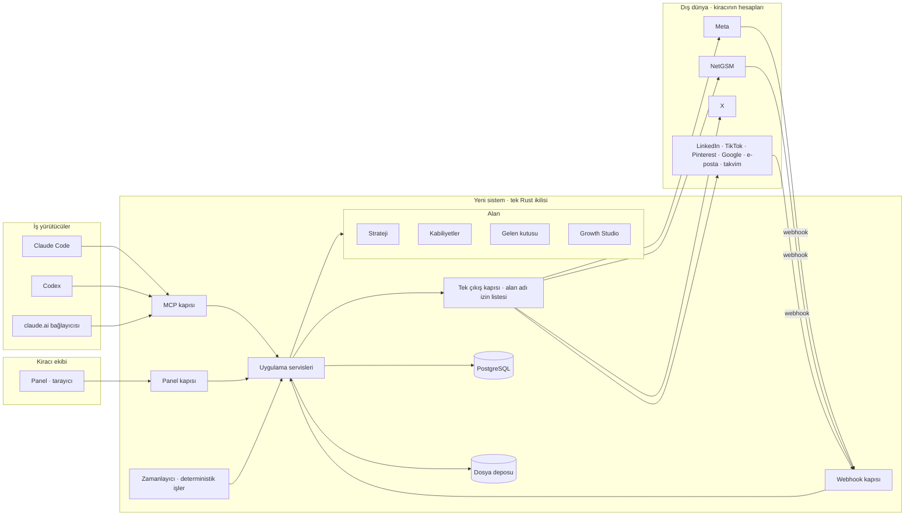

# Jeeta'nın Rust ile yeniden yazımı: tasarım

Tarih: 2026-10-22. Durum: hakem turu tamamlandı, sahibin onayına sunulan taslak.
Bu belge 2026-10-02 tarihli "mikroservis ve hexagonal mimari" tasarımının yerine geçer; o belge
tarihsel kayıt olarak kalır. Burada "v1" bugün canlıda çalışan TypeScript sistemdir, "yeni sistem"
bu belgenin anlattığıdır. Yeni sistemin adı sahibin seçimine bırakılmıştır; sürüm etiketleri v1'in
`v*.*.*` etiketleriyle çakışmayacak biçimde seçilir.

---

## 1. Sahibin istediği

> projeyi tamamen refaktör ediyoruz sistemi hexagonal mimari ile rust ile yazacağız … Sistem kesinlikle
> ama kesinlikle hiç bir yerinde api kullanmasın amacımız claude'un veya codex'in kullanacağı mcp ve
> aracı geliştirmek … video üretmek için de hiç api kullanma … Şirket hakkında strateji oluşturmadan
> hiçbir şeye başlanmasın strateji her şey, stratejiyi oluşturmak için istişare edilmesi gerekiyor.

> ilki kabiliyetler kısmı olsun … bağlı olan hesaplar olabilir hesaplar gruplandırılabilsin bağlı olan
> cihazlar olabilir bağlı olan bütçe kalemleri olabilir claude codex bağlantısı olabilir bilgisayarın
> erişimleri olabilir ses aygıtları olabilir ya da yazıcılar telefonlar 3d printerlar, 3. party
> entegrasyonlar.

> İkincisi gelen kutusu olsun … tasarım bakımından geliştirilebilir … lead mantığını detaylı incele
> burda hatalar var bence mantık olarak eksiksiz ve akışkan olsun istiyorum.

> Üçüncü kısım ise growth studio … kurulum diye bir sekme var bunu tamamen koddan kaldır … komisyonlar
> da aynı şekilde … growth studio ile alakası yok lead ile alakası var … amacına uygun olmayan gereksiz
> veya teferruat olan her şeyi çıkar.

> dış dünyaya yine buranın aracılığıyla dokunduğu yerler de olacak … netgsm meta twitter gibi
> bağlantıları da burdan kullanacak … iş yürütücüler tamamen claude ve codex olacak.

## 2. Sahibin verdiği kararlar (hepsi 2026-10-22)

| # | Konu | Karar |
|---|---|---|
| K1 | Sınır | Dış dünyaya dokunan **eller** Claude ve Codex'tir. Kanal bağlayıcıları (NetGSM, Meta, X ve envanterdeki diğer hesap bağlantıları) yeni sistemin **içinde** durur; ajan onları MCP araçlarıyla kullanır. Yapay zekâ, görsel ve video üretimi, ses tanıma ve seslendirme sağlayıcıları **yasaktır**. |
| K2 | Strateji | Onaylı strateji yokken hiçbir iş başlamaz. Strateji istişare ile oluşur. |
| K3 | Ürün biçimi | **Çok kiracılı ürün.** Her çalışma alanı kendi hesaplarını ve kendi Claude veya Codex'ini bağlar. |
| K4 | Para | **Tek seferlik ödeme.** Kredi, paket, abonelik, ek paket ve deneme süresi yoktur. |
| K5 | İnsan yüzü | **Panel** birincil bakış yeridir; Claude ile sohbet de aynı işleri yapabilir. |
| K6 | Bağlantı sayısı | Her bağlantı türünden **birden çok** kurulabilir; çalışma alanı başına teklik yoktur. |
| K7 | Ekip | Kiracı tarafında v1'deki gibi **ekip** vardır: sahip, yönetici, temsilci, özel roller. |
| K8 | Özerklik | Ajan gönderiyi **insan görmeden yayınlar**. |
| K9 | Sıra | Önce strateji kapısı ve kabiliyetler, sonra gelen kutusu, en son stüdyo. |
| K10 | Stüdyo tasarımı | Sahip "en profesyonel ve kusursuz olanı" istedi; §8'deki tasarım bu istekle seçildi. |
| K11 | Onay yetkisi | "Güvenlikten ziyade etkili olmak önemli." Tek kullanımlık onay kodu **yalnız ödemede** vardır; strateji onayı dahil diğer her şey sohbetten de verilebilir. |
| K12 | Ücretli şerit derinliği | Sahip "olması gereken neyse onu yap" dedi; §8.2'deki kapsam (dış yaratılan reklam setlerini bağla, bütçe ve ölçüm; yaratma yok) benim kararımdır. |
| K13 | Teklif, randevu, müşteri ödemesi | Sahip "ne yapılması gerekiyorsa yap" dedi; §7.1'deki küçültülmüş kapsam benim kararımdır. |

## 3. Hedef, kapsam, başarı ölçütleri

**Hedef.** Bir işletmenin pazarlama ve satış işini Claude veya Codex'in yürüttüğü, insan ekibin
baktığı ve istediğinde devraldığı, her eylemi onaylı bir stratejiye bağlayan, kendi içinde yapay zekâ
barındırmayan çok kiracılı bir ürün.

**Kapsam içi.** Strateji kapısı ve istişare kaydı; kabiliyet kayıt defteri ve gruplar; kanal
bağlayıcıları (mesajlaşma, telefon, yayın, reklam, takvim, e-posta); kişi, konuşma ve satış yolculuğu
mantığıyla gelen kutusu; komisyon; Growth Studio (hipotez, plan, parça, yayın, ölçüm, öğrenme, iki
şerit, günlük); panel ve MCP ikizliği; çok kiracılık, ekip ve roller; tek seferlik ödeme.

**Kapsam dışı.** v1 verisinin taşınması (yeni sistem temiz başlar, v1 geçişe kadar çalışır); kredi,
paket, abonelik, bayi faturalama, kupon; saha kurulumları; satış raporları; v1'in siteler, kurslar,
form oluşturucu, sipariş formu gibi yan ürünleri (§13'te genişleme noktası olarak bırakılır);
araştırma ve trend sağlayıcı bağlayıcıları (ajan kendi araçlarıyla yapar); her türlü yapay zekâ ve
medya üretim sağlayıcısı.

**Başarı ölçütleri.** Her biri bir kilometre taşının kabul testidir (§14).

| # | Ölçüt |
|---|---|
| B1 | Onaylı strateji yokken strateji ve kabiliyet araçları dışındaki her MCP aracı ve her panel eylemi `STRATEJI_GEREKLI` yapısal hatasını döner. Bu, bir mimari testle her kullanım durumu için kanıtlanır. |
| B2 | İkilinin bağımlılık ağacında yasaklı sağlayıcı kütüphanesi yoktur ve çalışma zamanında izin listesi dışında hiçbir alan adına çıkış yapılamaz. İkisi de otomatik testtir. |
| B3 | Aynı kimlik değerini taşıyan iki etkin kişi yaratılamaz. Kapalı konuşmaya gelen mesaj onu yeniden açar, yeni konuşma açmaz. |
| B4 | Yolculuk durumu yalnız olay indirgeyicisi tarafından yazılır; durum yazan dış uç yoktur. Bir mimari test, durum alanına yazan tek kodun indirgeyici olduğunu doğrular. |
| B5 | "Kaybedildi" olayından sonra o kişiye ajan yazamaz, açık görevler iptal olur, konuşmalar kapanır. |
| B6 | Her yayın ve her reklam hamlesi bir hipoteze ve bir strateji sürümüne bağlıdır; bağsız yayın mümkün değildir. |
| B7 | Ücretli şeritte stratejinin bütçe çerçevesi aşılamaz; aşma denemesi hata döner, onay istemez. |
| B8 | Her kullanım durumu için panel ucu ve MCP aracı aynı uygulama servisini çağırır; ikizlik testi her kullanım durumunun iki kapıdan da erişilebilir olduğunu sayar. |
| B9 | Acil fren basıldığında iki şerit de bir saniye içinde durur; kuyruktaki yayın gitmez, bütçe hamlesi uygulanmaz. |
| B10 | Aynı türden iki bağlantı (örneğin iki NetGSM hattı, iki Claude bağlantısı) aynı çalışma alanında yan yana çalışır. |
| B11 | Panel, ajanın en son ne zaman iş aldığını gösterir ve ajan beklenen aralıkta gelmemişse uyarır. |

## 4. Omurga

### 4.1 Tek resim



### 4.2 Üç kural

1. **Kanal bağlayıcıları içeride, zekâ ve üretim dışarıda.** Kiracının hesabı olan her platformla
   konuşan kod sistemin içinde bir sürülen adaptördür. Düşünen, yazan, üreten, karar veren tek şey
   ajandır. Ajan ürettiği metni ve dosyayı sisteme verir; sistem saklar, zamanı gelince yayınlar,
   sonucu okur ve kaydeder.
2. **Sistem yalnız önceden kararlaştırılmış, deterministik işleri yürütür.** Zamanı gelen gönderiyi
   yollamak, gelen kutusunu okumak, metrik çekmek, webhook almak, SMS göndermek, bütçe yazmak.
   Hangi gönderinin yazılacağı, kime ne yanıt verileceği, bütçenin nereye kayacağı ajanın kararıdır.
3. **Ajanı uyandırmak sistemin işi değildir.** Ajan kendi zamanlayıcısıyla gelir ve "sırada ne var"
   diye sorar. Sistem bekleyen işleri sırayla sunar, ajanın geliş zamanını kaydeder, gecikmeyi panelde
   gösterir (B11).

**(M1a uygulamasında kesinleşti) B11 mekaniği.** Ajanın giriş noktası `jeeta.work.pending`'dir
(panelde `GET /api/work/pending`, ana sayfanın verisi): stratejinin durumu (yok, taslak açık ve
eksikleri, onay bekliyor, onaylı sürüm numarası), en acil olanı başta bekleyen işler (istişare, onay,
ajan ve cihaz kabiliyetlerinin doğrulanması ya da yeniden doğrulanması, bağlayıcının bağlanması, ilk
kabiliyetin bildirilmesi; her biri ajan için İngilizce bir ipucuyla) ve ajanın durumu. Ajan kendi
zamanlayıcısıyla en az yoklama aralığında bir `jeeta.work.checkin` çağırır; yanıtı `pending` ile
aynıdır. Yoklama yalnız ajanın çağrısıdır (insan çağırırsa `FORBIDDEN`), bağlantı başına saatte en çok
bir kez günlüğe yazılır; ajanın her çağrısı bağlantısının son görülme zamanını zaten günceller. Aralık
çalışma alanı başınadır, 15 dakika ile bir hafta arası, varsayılanı bir gündür (`team.manage` ile
değişir). `overdue`: hiç ajan bağlantısı yok ya da en son görüleni aralıktan eski; panelin ana sayfası
kırmızı bir uyarı, Ajanlar sayfası her bağlantının satırında bir işaret gösterir. Bekleyen işler ve
yoklama strateji kapısından da çalışma alanı durumu denetiminden de muaftır: ajan strateji yokken ve
alan ödeme beklerken de neyin beklediğini sorabilir.

### 4.3 Hexagonal yerleşim (Rust)

Tek Cargo çalışma alanı, tek süreç, tek ikili. Üç başlık ayrı alan kütüphaneleridir; ileride servis
olarak ayrılmaları mümkündür ama bu belge onu istemez. Bu benim kararım: tek süreç en az hareketli
parçadır ve kiracı sayısı büyüyene kadar yeterlidir.

```
crates/
  domain/strateji      saf: varlıklar, olaylar, kurallar, indirgeyiciler   (I/O yok)
  domain/kabiliyet
  domain/gelen_kutusu
  domain/studio
  app/                 kullanım durumları; port trait'leri burada tanımlanır
  adapters/mcp         sürücü: MCP (HTTP akışlı taşıma + yerel stdio)
  adapters/panel_http  sürücü: panelin JSON ucu ve statik dosyalar
  adapters/webhook     sürücü: sağlayıcı webhook'ları (imza doğrulama, tekilleştirme)
  adapters/postgres    sürülen: depolar, geri alınabilir göçler (.up.sql / .down.sql)
  adapters/fs          sürülen: dosya deposu (ilk sürüm yerel disk)
  adapters/connectors/ sürülen: meta, netgsm, x, linkedin, tiktok, pinterest, google, email, calendar
  adapters/outbound    tek HTTP çıkış istemcisi; alan adı izin listesi burada zorlanır
  bin/                 ana ikili: bağlama, yapılandırma, zamanlayıcı
```

Zorlanan sınırlar (hepsi otomatik test):

- `domain/*` hiçbir adaptöre ve hiçbir I/O kütüphanesine bağımlı değildir.
- Dış HTTP yalnız `adapters/outbound` üzerinden çıkar; başka hiçbir crate HTTP istemcisi
  içermez. `cargo-deny` yasak listesi: her yapay zekâ, medya üretim, ses tanıma ve seslendirme
  istemcisi; ayrıca `adapters/outbound` dışında HTTP istemcisi.
- `adapters/outbound` yalnız izin listesine çıkar. Liste iki katmanlıdır: **sabit katman**
  bağlayıcı başına sağlayıcı alan adlarıdır ve testte sabitlenir; **kiracı katmanı** kiracının
  kabiliyet kaydına yazdığı sunuculardır (SMTP ve IMAP sunucusu, OIDC sağlayıcısı) ve yalnız o
  kayıttan gelir. B2 sabit katmanı ve "kiracı sunucusu yalnız kabiliyet kaydından gelir" kuralını
  doğrular. SMTP ve IMAP de bu kapıdan geçer; HTTP olmayan tek çıkış onlardır.
- Her depo sorgusu çalışma alanı kimliğiyle süzülür; süzgeçsiz sorgu derlenmez (tip düzeyinde
  zorlanır) ve ayrıca mimari testle taranır.
- Yolculuk durumuna yazan tek kod indirgeyicidir (B4).
- Her kullanım durumunun bir MCP aracı ve bir panel ucu vardır (B8).

**(M1b uygulamasında kesinleşti) Sabit katmanın listesi ve çıkış istisnaları.** Sabit katman
bağlayıcı başına şu adlardır, başka hiçbiri değil (`jt_outbound::FIXED_HOSTS`, testte birebir):
`meta` → `graph.facebook.com`, `graph.instagram.com`, `api.instagram.com`, `rupload.facebook.com`;
`netgsm` → `api.netgsm.com.tr`, `whatsappapi.netgsm.com.tr`, `sesdosya.netgsm.com.tr`,
`crmsntrl.netgsm.com.tr:9111`; `x` → `api.twitter.com`, `api.x.com`. Sağlayıcı bağdaştırıcıları
(`jt_meta`, `jt_netgsm`, `jt_x`) HTTP istemcisi tutmaz, yalnız `Egress::send(EgressScope::Connector(..))`
ile çıkar; `reqwest` yalnız `adapters/outbound`'dadır ve başka hiçbir paket onu bağımlılığında ya da
kaynağında anmaz (mimari test; tek istisna MCP testlerinin dev-bağımlılığındaki istemcidir, ikiliye
girmez). Tarayıcının gittiği giriş sayfaları (`www.facebook.com`, `www.instagram.com`, `twitter.com`)
çıkış değildir, sunucu yalnız adreslerini kurar. Çıkışın istisnaları ve ek denetimleri §4.4'teki M1b
bloğundadır: yalnız `netgsm` kapsamında `crmsntrl.netgsm.com.tr:9111` için düz `http` (Netsantral'ın
tıkla-ara ucu, sağlayıcı sınırı), her adın çözüldüğü adresin genel olması (sabit adlar dahil), testlere
özgü `test-loopback` derlemesinin üretimde açılmaması ve kiracı katmanının her açılışta canlı bağlayıcı
kabiliyetlerinden yeniden kurulması.

### 4.4 Kapılar

| Kapı | Kim | Kimlik |
|---|---|---|
| MCP | Claude Code, Codex, claude.ai bağlayıcısı | Çalışma alanı API anahtarı (hash'li, kapsamlı) ya da OAuth 2.1 + PKCE (claude.ai için). Her bağlantı bir **ajan bağlantısı** kabiliyetidir; `initialize` içindeki istemci bilgisi ve her araç çağrısı bu bağlantıya yazılır. |
| Panel | kiracı ekibi | Oturum çerezi, `httpOnly`; e-posta ve parola, isteğe bağlı OIDC. |
| Webhook | sağlayıcılar | Sağlayıcı imzası; kiracı eşlemesi bağlayıcı örneğinin kimliğiyle. |
| Yerel stdio | geliştirici, tek kiracılı yerel kullanım | işletim sistemi kullanıcısı |

API anahtarı onu çıkaran insanın rolünü taşır: sahibin anahtarıyla gelen ajan sahibin yapabildiğini
yapar, temsilcinin anahtarıyla gelen ajan temsilcinin yapabildiğini. Anahtar kapsamla daraltılabilir
ama genişletilemez. Her çağrı hem insanı hem ajan bağlantısını günlüğe yazar. Yalnız insana ayrılan
tek eylem ödemedir (K11, §9).

**(M0 uygulamasında kesinleşti)** Ajan, anahtarı çıkaran insanın rol anahtarını (`role_key`) devralır;
izinleri, o insanın o anki izinlerinin anahtar kapsamlarıyla daraltılmış hâlidir (insanın rolü
düşerse anahtarın etkin kapsamı da bir sonraki çağrıda düşer). Sahibe özgü yetkiler (sahip rolü
vermek, bir sahibin rolünü değiştirmek ya da onu çıkarmak) sahibin `team.manage` kapsamını taşıyan
bir anahtarıyla ajana geçer.

**(M0 uygulamasında kesinleşti) MCP oturumları.** Akışlı HTTP'de her MCP oturumu (`Mcp-Session-Id`)
onu açan API anahtarına bağlıdır. Başka bir anahtarın oturum kimliği de, bilinmeyen ya da bağı
düşmüş (silinmiş, bellek sınırını aşınca en eskisi olarak düşürülmüş) bir oturum kimliği de aynı
biçimde reddedilir: `404 NOT_FOUND`, "unknown session"; istemci yeniden `initialize` eder. Denetim
kapalı başarısız olur: bir oturum kimliği yalnız isteğin kendi anahtarına bağlıysa geçer.

MCP araç adları `jeeta.<alan>.<eylem>` biçimindedir. Her araç yapısal hata döner; en önemlileri
`STRATEJI_GEREKLI`, `KABILIYET_YOK`, `BUTCE_TAVANI`, `FREN_BASILI`, `YETKI_YOK`. Araçlar risk etiketi
taşır: OKU, YAZ, HARCA, YIKICI. Yıkıcı araçlar (kişi birleştirme geri alma, strateji arşivleme gibi)
iki adımlı onay ister; diğerleri K8 gereği istemez.

**(M1a uygulamasında kesinleşti) Onay isteyen yıkıcı araçlar ve anahtar yetkisi.** İki adımlı onay,
çağrının kendisinde `confirm: true` olarak istenir (yoksa `VALIDATION`) ve M1a'da yalnız geri
alınamayan iki yıkıcı araçta vardır: `jeeta.strategy.archive` (onaylı sürümü arşivler ve strateji
kapısını yeniden kapatır) ve `jeeta.capability.retire` (kabiliyeti kesin olarak emekliye ayırır, ona
kayıtlı dış adreslerin iznini geri alır, gruplarından ve bütçe bağlarından çıkarır). YIKICI etiketli
öteki araçlar `confirm` istemez, çünkü etkileri onarılabilir ya da yeniden kurulabilir: çıkarılan üye
yeniden davet edilir (`team.remove`), silinen özel rol yeniden açılır (`roles.delete`), iptal edilen
anahtarın yerine yenisi çıkarılır (`api_keys.revoke`), silinen kabiliyet grubu yeniden kurulur ve
üyeleri yerinde kalır (`capability.groups_delete`). Grup silmenin onarılabilir olması, gruba hiçbir şeyin
başvurmamasına bağlıdır: onaylı sürüm ya da açık taslak bir kanalı o gruba daraltmışsa
(`ChannelChoice.group_id`) silme `CONFLICT` ("group is referenced by the strategy", `details.version_ids`)
döner ve hiçbir şey değişmez. Bu eylemlerin yetkisi onaydan değil rolden gelir:
onaylamak ve arşivlemek gibi role bağlı eylemler, rol anahtarıyla birlikte `team.manage` iznini anahtarın
kapsamı içinde ister ve ajan bu yetkiyi anahtarı çıkaran insandan devralır (§5).

**(M1b uygulamasında kesinleşti) Bağlayıcı hataları ve onay listesi.** Bir kullanım durumu sağlayıcıya
eşzamanlı çağrı yapar da sağlayıcı geçici olarak yanıt vermez ya da hız sınırı koyarsa (`Throttle`,
`Transient`), yapısal hata kodu `UPSTREAM_UNAVAILABLE`'dır (panelde HTTP 503; MCP'de aynı gövde):
`details = { provider, retryable: true, retry_after_s?, reason }` ve `reason` her zaman gizli-değer
maskesinden geçer. Yoklama (`connector.probe`) başarısızlığı bir hata değil sonuçtur; o yüzden bu kodu
döndürmez. `confirm: true` isteyen yıkıcı araç listesine `jeeta.budget.items_retire` eklendi: emekli
bütçe kalemi bağ ve harcama almaz, bağları aynı işlemde silinir, harcama geçmişi kalır. Tek HTTP çıkış
kapısı iki istisna ve iki ek denetim kazandı: (1) yalnız `netgsm` kapsamında, yalnız
`crmsntrl.netgsm.com.tr:9111` için düz `http` (Netsantral'ın tıkla-ara ucu; sağlayıcı sınırı olarak
belgelenir); (2) ad çözümleme anında özel adres aralığına çözünen her ad reddedilir (sabit sağlayıcı
adları dahil; `resolve_public` M2'nin SMTP/IMAP soketleri için de tek paylaşılan süzgeçtir); (3)
yalnız geliştirme testlerinin açtığı `test-loopback` özelliği derlemeye girmişse ikili
`JEETA_ALLOW_TEST_LOOPBACK=1` olmadan açılmayı reddeder; (4) kiracı katmanı her açılışta canlı
bağlayıcı kabiliyetlerinin `connector_public.hosts` listesinden yeniden kurulur, emekli kabiliyetin
adresleri düşer.

**(M1b uygulamasında kesinleşti) Webhook kapısı.** Sağlayıcılar sunucunun `/hooks/*` kapısını
(`adapters/webhook`) çağırır; kapı panelin oturum ve istek başlığı denetimlerinin dışındadır, güvenlik
başlıklarının ve rota şablonunu yazan erişim günlüğünün içindedir. Yanıtlar:

| İstek | Yanıt |
|---|---|
| `GET /hooks/meta` | `hub.mode=subscribe` ve platformun doğrulama anahtarı (sabit zamanda) için `hub.challenge` düz metin, `200`; aksi `403`; Meta uygulaması yapılandırılmamışsa `404` |
| `POST /hooks/meta` | imza başlığı ya da Meta uygulaması yoksa gövde okunmadan `401`; 3 MB üstü `413`; `X-Hub-Signature-256` ham gövde üzerinde Meta uygulamasının sırrıyla, Instagram uygulaması varsa onunkiyle de sabit zamanda denetlenir, tutmazsa `401` ve hiçbir şey yazılmaz; ayrıştırılamayan imzalı gövde `200` (sayılır, yazılmaz); olaylar yazılınca ya da kurala göre atılınca `200 EVENT_RECEIVED`; veritabanı hatası `500` |
| `POST /hooks/netgsm/{workspace_id}/{anahtar}/{amaç}` | çözülemeyen parça, bilinmeyen amaç, bozuk alan kimliği, alanın o amaç için olmayan anahtarı (sabit zamanda), var olmayan ya da askıya alınmış (`suspended`) alan: hepsi gövde okunmadan çıplak `404`; 256 KB üstü `413`; okunamayan gövde `202` (sayılır, yazılmaz); olaylar yazılınca `202`; veritabanı hatası `503` |

İki sağlayıcı farklı yönlendirilir. **Meta** bir imzayla bütün platforma gelir: her olay hesabıyla
(sayfa, Instagram hesabı, WhatsApp numarası) bütün alanlarda aranır ve hesabı bağlı tutan (mühürlü,
en az bir kez doğrulanmış, emekli değil) tek kabiliyetin alanına yazılır; böyle bir alan yoksa olay
atılır. **NetGSM** imzalamaz: her alanın her amaç için kendi adresi vardır, adresteki anahtar alanın
gizli anahtarından o amaç için türetilen HMAC'tir; olay adresin adladığı alana yazılır ve o amacın
türündeki tek canlı kabiliyete bağlanır (hiç ya da birden çok varsa hiçbirine). Böylece NetGSM'in
yönlendirmesi hesaba değil alanın anahtarına dayanır; §6.4'teki "yalnız en az bir kez doğrulanmış
kabiliyete yönlenir" kuralı Meta'nın hesap yönlendirmesi içindir. **Alanın durumu:** Meta olayları
hesabı tutan alan etkin ya da ödeme bekliyor (`pending_payment`) iken yazılır, askıya alınmışsa
(`suspended`) atılır (hiçbir yere satır yazılmaz, `unrouted_meta` sayacı artar, günlüğe yalnız
sağlayıcı, `reason=inactive`, hesap türü ve sayı yazılır; Meta'ya yine `200`); NetGSM adresi etkin ve
ödeme bekleyen alanlar için açıktır, askıdaki alan için `404`'tür. **Ham gövde alanındır:** bir Meta
teslimi birkaç alanın hesaplarını bir arada taşıyabilir; her alan yalnız kendi olaylarının geldiği
parçayı saklar (`{"object", "entry": [yalnız kendi girdileri]}`, WhatsApp girdisinde yalnız kendi
numaralarının `changes` öğeleri; ayrıştırılmış değerden yeniden yazılır, imza özgün gövdeyi kapsar, bunu
değil); gövdenin tamamı o alanınsa olduğu gibi saklanır. Hiçbir alanın almadığı bir öğe (yönlenmeyen
hesap, askıdaki alan, olay çıkmayan öğe) hiçbir yerde saklanmaz. NetGSM gövdesi tek alanı adlar ve
olduğu gibi saklanır. Hiçbir yanıt, günlük satırı ya da sayaç gövde, hesap kimliği ya da anahtar
taşımaz. Sağlayıcının serbest metninde yinelenen sırlar da maskelenir: bir çağrının bilinen sırları (o
anki jeton, uygulama sırrı, yetki kodu, istemci sırrı) sağlayıcının mesajından, kendisine çözülen her
yazımıyla (olduğu gibi; herhangi baytları kaçışlı, her harf büyüklüğünde yüzde kodlu; boşluk yerine `+`;
bunların üç tura kadar iç içe uygulanmışı) kısaltmadan önce çıkarılır, genel maske ardından uygulanır.

### 4.5 Panel ve MCP ikizliği

Panelde yapılabilen her iş bir MCP aracıyla da yapılabilir; tersi de geçerlidir. İkisi aynı uygulama
servisini çağırır (B8). Panel ayrıca ajanın ne yaptığını gösterir: her alanın bir **günlüğü** vardır ve
ajanın eylemleri orada insan eylemleriyle aynı biçimde durur.

**(M1a uygulamasında kesinleşti) MCP'ye özgü kullanım durumları.** "Tersi de geçerlidir" kuralının tek
istisnası insan çağıranı olmayan kullanım durumudur: kataloğun `mcp_only` satırları panel rotası
taşımaz. M1'de tek böyle satır ajanın yoklamasıdır (`work.checkin`, `jeeta.work.checkin`); panel onun
sonucunu (son görülme, gecikme) `work.pending` ve `agents.list` ikizleriyle gösterir. Bir satır hem
panele hem MCP'ye özgü olamaz; ikizlik testi `mcp_only` satırlarını panel rotası olmadan kabul eder ve
M1a'nın kaydı 47 MCP aracı tutar.

Panelin teknolojisi benim kararımdır: React ve TypeScript, v1'in tasarım sistemi (otuz yedi hazır
bileşen) yeniden kullanılır, Rust ikilisi statik dosyaları sunar. Diller: Türkçe ve İngilizce; v1'in
diğer üç dili ilk sürümde yoktur.

**Adlandırma.** Bu belgedeki Türkçe adlar (Kişi, Yolculuk, Yuva, `jeeta.gelen.yanitla`) alanın
ortak dilidir ve panelde görünen dildir. Kodda, veritabanında ve MCP araç adlarında İngilizce
kullanılır (`person`, `journey`, `slot`, `jeeta.inbox.reply`); Ek B her Türkçe terimin İngilizce
karşılığını verir ve kod o tabloya uyar. `jeeta.` öneki ürün adının yer tutucusudur; sahip adı
seçince önek onu izler. Bu benim kararım: depo herkese açıktır, v1 İngilizcedir ve ajanlar İngilizce
araç adlarıyla daha isabetli çalışır.

## 5. Strateji kapısı

**Kök varlık.** Her çalışma alanının stratejisi sürümlüdür: `taslak`, `onaylı`, `arşiv`. Bir anda tek
onaylı sürüm vardır. Sonradan doğan her şey (kabiliyet politikası, yolculuk, yuva, bütçe hamlesi)
doğduğu strateji sürümünün kimliğini taşır.

**Kapı kuralı.** Onaylı sürüm yokken `jeeta.strateji.*` ve `jeeta.kabiliyet.*` dışındaki her araç ve
panel eylemi `STRATEJI_GEREKLI` döner (B1). Kabiliyet araçları açıktır çünkü istişare, bağlı
hesapları bilmek ister.

**Kapıdan muaf olanlar** (B1 testi bu listeyi sabitler): kayıt ve giriş, çalışma alanı ayarları,
ekip ve davet, API anahtarı çıkarma, ödeme, acil fren, günlük okuma, strateji ve kabiliyet araçları.
Bunların da panel ve araç ikizi vardır (B8); yalnız kayıt, giriş ve ödeme panele özgüdür.

**(M0 uygulamasında kesinleşti)** Panele özgü kullanım durumlarının gerçek listesi: kayıt, giriş,
çıkış, oturumun kendi bilgisi (`auth.me`; ajandaki karşılığı `agents.whoami` ikizidir), çalışma alanı
değiştirme, davet kabulü, platform işlemleri (işletmen girişi, çalışma alanlarını listeleme ve
durumlarını değiştirme) ve ödeme. Bir ajan bir insanın oturumunu ya da davet jetonunu hiç taşımaz.
Geri kalan her kullanım durumunun panel ve MCP ikizi vardır.

**(M0 uygulamasında kesinleşti) Çalışma alanı durumu.** Durum denetimi strateji muafiyetinden
bağımsız ikinci bir denetimdir: çalışma alanı `pending_payment` ya da `suspended` iken `auth.*`,
`workspace.*` ve `platform.*` dışındaki her kullanım durumu, stratejiden muaf olsa bile, panelden de
MCP'den de `WORKSPACE_INACTIVE` döner. Bu yüzden ödeme bekleyen bir alan, işletmen onu
etkinleştirene kadar üye davet edemez ve API anahtarı çıkaramaz; askıdaki bir alana bekleyen bir
davet de kabul edilemez. Panelde bu denetim her rotanın önünde, işleyicinin ne aldığından bağımsız
çalışır.

**(M1a uygulamasında kesinleşti) Strateji ve bekleyen işler ödemeden önce.** Strateji araçları
(`strategy.*`) ve bekleyen işler (`work.*`) durum denetiminden **yalnız alan `pending_payment` iken** muaftır:
strateji, alan ödeme beklerken de hazırlanıp onaylanabilir; ajan da neyin beklediğini sorabilir. Alan
`suspended` iken onlar da `WORKSPACE_INACTIVE {"status":"suspended"}` döner; askıdaki bir alanda yalnız
`auth.`, `workspace.` ve `platform.` önekliler çalışır. Her durumda muaf önekler tam olarak `auth.`,
`workspace.`, `platform.`'dur; ödeme beklerken muaf olanlar tam olarak `strategy.`, `work.`'tür. Ödeme
bekleyen bir alan stratejiyi hazırlar ama etkinleşene kadar kabiliyet bildiremez. Strateji kapısından muaf
olanlar ise
`auth.`, `workspace.`, `team.`, `roles.`, `api_keys.`, `agents.`, `platform.`, `strategy.`,
`capability.`, `budget.`, `work.` önekleri ile `ledger.list`'tir; kabiliyet ve bütçe araçları stratejiden
muaftır (istişare alanın neye sahip olduğunu bilmek ister) ama durumdan muaf değildir. M1a hiçbir `Gated`
kullanım durumu eklemez; B1'in davranış testi gerçek kapıyla (`PgStrategyGate`) çalışır.

**Strateji yokken gelen mesaj.** Kiracı bir hattı bağlamış ve müşteri yazmışsa mesaj düşmez:
kişi ve konuşma kaydedilir, panelde görünür, yürütücü insandır. Ajan o konuşmaya yazamaz; panel
"strateji bekleniyor" uyarısı gösterir. Bu benim kararım: müşteriyi kaybetmek kapıdan daha pahalıdır.

**Kapsam.** Strateji çalışma alanı başına tektir. İki ayrı marka iki ayrı çalışma alanıdır; v1'in
çoklu çalışma alanı üyeliği ve geçiş menüsü taşınır. Gruplar (§6.3) tek markanın içindeki şube,
hat ve amaç ayrımı içindir. Bu benim kararım.

**İstişare.** Sohbette ajan ile sahip arasında geçer; sistem onu yapılandırır ve kaydeder:

| Araç | İş |
|---|---|
| `jeeta.strateji.istisare_baslat` | yeni taslak sürüm açar; v1'in sorgu çerçevesini (kimlik, kitle, kanallar, sütunlar, hedefler, bütçe, rakipler) bölüm olarak verir |
| `jeeta.strateji.soru_kaydet` / `cevap_kaydet` | sorulan soru ve alınan cevap; kim sordu, kim cevapladı |
| `jeeta.strateji.varsayim_kaydet` | ajanın cevap alamadan koyduğu varsayım; onayda açıkça listelenir |
| `jeeta.strateji.bolum_yaz` | bir bölümün taslağı |
| `jeeta.strateji.onaya_sun` | taslağı sahibin onayına çıkarır; panelde "onay bekliyor" |
| `jeeta.strateji.onayla` | sahip ya da yönetici rolü; panelden ya da sohbetten, ek kod istemez (K11) |

**(M1a uygulamasında kesinleşti) İstişare araçları.** Kodda araçlar şunlardır: `jeeta.strategy.get`
(onaylı sürüm, açık taslak ve taslağın eksikleri; açıklaması ajana protokolü söyler),
`start_consultation` (taslak açar ya da açık olanı döndürür; onaylı sürüm varsa taslak onun kopyasıdır),
`record` (soru, cevap, varsayım ve not tek araçtır, `kind` ile ayrılır), `write_section`,
`set_hypotheses`, `submit` (eksik varsa `VALIDATION` ve `details.gaps`), `approve`, `archive`,
`list_versions`, `consultation` (sürümün kaydı, `(at, id)` imleciyle sayfa sayfa). Okuma `workspace.read`,
istişareyi yürütmek `team.manage` ister. **Onay ve arşiv yetkisi:** rol anahtarı `owner` ya da `manager`
**ve** `team.manage` (anahtarın kapsamı dahil): ajan sahibin ya da yöneticinin `team.manage` taşıyan
anahtarıyla onaylayabilir, kapsamında `team.manage` olmayan bir sahip anahtarı onaylayamaz; ek kod
istenmez (K11).
**Arşiv sürümünü adlandırır:** `jeeta.strategy.archive` arşivlenecek onaylı sürümün kimliğini
(`version_id`) ve `confirm: true` ister; o sürüm artık yürürlükte değilse `CONFLICT` döner, böylece eski
bir ekrandan gelen arşiv yeni onaylanmış sürümü kapatmaz.
**Onay da taslağı adlandırır ve varsayımlar onayda listelenir:** bir taslağın yanıtı istişarenin
`assumption` kayıtlarını (en yenisi başta) `assumptions` alanında taşır; panel onaydan önce bunları ve
yürürlüğe girecek hipotez sayısını bir onay penceresinde gösterir, `jeeta.strategy.approve` açıklaması da
ajana varsayımları sahibe okumadan onaylamamasını söyler. `approve`, okunan taslağın `version_id` ve
`submitted_at` değerlerini ister; kilitler alındıktan sonra taslak başka bir sürümse ya da yeniden
sunulmuşsa `CONFLICT` ("the draft changed since you read it", taslağın şimdiki `version_id` ve
`submitted_at` değerleriyle) döner, böylece sahip gözden geçirmediği bir taslağı onaylamaz.

**İçerik.** Strateji şu bölümlerden oluşur: kimlik (ürün, ses, konumlama, fark); kitle ve segmentler;
kanallar ve her kanalın gerekçesi; **hipotezler** (eski adıyla içerik sütunları: "şu segment, şu
açıya, şu kanalda tepki verir"; her biri sınanabilir ve bir ölçüte bağlı); hedefler ve ölçütler;
**bütçe çerçevesi** (şerit başına dönemlik tavan; §9); yasaklar (söylenmeyecekler, girilmeyecek
konular); tempo (haftalık yayın sayısı, kanal dağılımı); ücretli kanal var mı.

**(M1a uygulamasında kesinleşti) Onay için kanallar.** Stratejinin seçtiği her kanal `any` ya da alanın
emekliye ayrılmamış bir kabiliyetinin türüdür (kabiliyet kaydından okunur); bir kanal bir kabiliyet
grubuna daraltılmışsa (`ChannelChoice.group_id`) o grup alanın var olan bir grubudur; her canlı
hipotezin kanalı stratejinin **kendi seçtiği** kanallardan biri ya da `any`'dir (alanın sahip olduğu ama
stratejinin seçmediği bir tür yetmez). Aykırı her durum onayı ve onaya sunmayı `VALIDATION` ile durdurur,
eksik alan yoluyla sayılır.

**Yeni sürüm.** Bütçe çerçevesini büyütmek, kanal eklemek, hipotez eklemek yeni bir sürümdür ve
istişareden geçer. Küçük düzeltmeler (yazım, ölçüt eşiği) aynı sürümde "not" olarak kaydedilir; bu
ayrımın çizgisi inşaatçıya bırakılmıştır.

**Sürüm değişince sürmekte olan iş.** Hipotezin kimliği sürümler arasında kalıcıdır: yeni sürüm
her hipotezi **korur**, **emekli eder** ya da **ekler**. Korunan hipotezin kolları ve öğrenilenleri
(alfa, beta, güven) olduğu gibi devam eder; emekli edilen hipotezin planlanmış ve ajandaki yuvaları
iptal olur, yayınlanmış olanlar ölçülmeye devam eder; eklenen hipotez boş kollarla başlar. Eski
sürümün bütçe çerçevesi yeni sürüm onaylandığı an biter. Onaylı tek sürüm arşivlenirse kapı yeniden
kapanır: planlanmış, ajandaki ve hazır yuvalar iptal, bekleyen bütçe hamleleri düşer, konuşmalar
"strateji yokken gelen mesaj" kuralına döner. Bu benim kararım.

## 6. Başlık 1: Kabiliyetler

### 6.1 Tek varlık

v1'de yirmi ayrı tablo kendi sağlık sözlüğünü taşıyordu. Yeni sistemde tek bir **Kabiliyet** varlığı
vardır:

| Alan | Anlam |
|---|---|
| tür | §6.2'deki listeden |
| ad, açıklama | kiracının verdiği ad |
| ulaşım yolu | üç çeşit: **bağlayıcı** (sistemin içindeki adaptör, kimlik bilgileri mühürlü), **ajan** (ajanın bildirdiği, sistemin dokunmadığı araç ya da erişim), **cihaz** (ajanın bildirdiği ve kanıtla doğruladığı fiziksel aygıt) |
| durum | `bildirildi`, `doğrulandı`, `ulaşılamıyor`, `emekli` |
| son doğrulama, kanıt | bağlayıcıda sistemin kendi deneme çağrısı; ajan ve cihazda ajanın sunduğu kanıt (çıktı, ekran görüntüsü kimliği, cihaz seri numarası) |
| gruplar | çoktan çoğa; §6.3 |
| politikalar | çalışma saatleri, günlük işlem tavanı, harcama tavanı, "insan onayı ister" bayrağı (varsayılan kapalı, K8) |
| bütçe bağları | hangi bütçe kalemlerinden harcar |
| strateji sürümü | politikaların doğduğu sürüm |

Her türden birden çok örnek olabilir (K6, B10). Kimlik bilgileri çalışma alanı başına ayrı anahtarla
mühürlenir (AES-256-GCM); anahtar makinede dosyadır, depoya girmez.

**(M1a uygulamasında kesinleşti) İzinler ve örnekler.** İki yeni izin: `capabilities.manage`
(kabiliyet bildirmek, doğrulamak, ulaşılamaz işaretlemek, politikasını yazmak, emekliye ayırmak,
gruplamak, bütçeye bağlamak) ve `budget.manage` (bütçe kalemi açmak). Sahip ve yönetici rolleri ikisini
de taşır, temsilci taşımaz; M1a'dan önce açılmış alanların sistem rollerine bir veri göçü
(`0004_role_permissions_backfill`, geri alınabilir) ekler. Okumak, harcama bildirmek ve ajanın kendi
kabiliyetini doğrulaması `workspace.read` ister. Aynı türden örnekler serbesttir; aynı dış hesap (tür ve
sağlayıcının kimliği) ise emekliye ayrılmamış tek bir kabiliyette durur. Çalışma alanı başına anahtar,
ana anahtardan (`JEETA_SECRET_KEY`) HKDF-SHA256 ile türetilir; ana anahtar değişirse mühürlü
yapılandırmalar açılamaz.

### 6.2 Tür listesi

| Grup | Türler | Ulaşım yolu |
|---|---|---|
| Hesap: sosyal | Instagram, Facebook sayfası, X, LinkedIn sayfası, TikTok, Pinterest, YouTube, Google İşletme | bağlayıcı (OAuth) |
| Hesap: mesajlaşma | WhatsApp Cloud, Instagram DM, Messenger, SMS hattı (NetGSM), e-posta kutusu (SMTP ve IMAP), web sohbet | bağlayıcı |
| Hesap: telefon | NetGSM Netsantral (tıkla-ara, IVR, kayıt) | bağlayıcı |
| Hesap: topluluk ve yorum | Discord, Reddit, Google ve Facebook yorum kaynakları | bağlayıcı |
| Hesap: reklam | Meta Ads, TikTok Ads, LinkedIn Ads, Google Ads | bağlayıcı (bütçe yazma, sonuç okuma, lead formu alma) |
| Hesap: takvim | Google Takvim ve Meet, Outlook ve Teams | bağlayıcı (OAuth) |
| Cihaz | telefon, bilgisayar, yazıcı, 3D yazıcı, mikrofon ve hoparlör, kamera, ekran, tarayıcı, USB depolama | cihaz (ajan bildirir ve kanıtlar) |
| Bütçe kalemi | nakit, reklam bütçesi, SMS bütçesi, ajan kotası, ajan çalışma saati, sarf malzeme | sistem içi; harcamayı bağlayıcılar yazar (reklam, SMS), ajan bildirir (kota, sarf) |
| Ajan bağlantısı | Claude Code oturumu, Codex oturumu, claude.ai bağlayıcısı; her birinin bildirdiği kendi araçları (ör. medya üretim aracı, tarayıcı, dosya erişimi) | sistem içi (MCP kapısı) + ajan bildirimi |
| Bilgisayar erişimi | dosya kökleri, açık oturumlu tarayıcı profilleri, kabuk, adb, ekran kontrolü | ajan |
| Üçüncü taraf | Notion, Slack, Gmail, Apify, Firecrawl gibi ajanın kendi bağlayıcıları | ajan (sistem yalnız kaydeder) |
| Ekip | insanlar ve rolleri | sistem içi (§11) |

"Bütçe kalemi" kiracının kendi parası ve kendi hesaplarındaki tavanlardır; sistemin kredisi değildir
(K4).

**(M1a uygulamasında kesinleşti) Türler, bütçe ve emeklilik.** Tür listesi on grupta 49 anahtardır;
listede olmayan tür `VALIDATION` alır, üçüncü taraf "diğer" türü aracın adını ayrıca ister. Bütçe
kaleminin birimi türüne uyar (nakit, reklam ve SMS bütçesi para birimiyle; ajan kotası ve sarf malzeme
sayıyla; ajan çalışma saati dakikayla) ve bir kabiliyet yalnız türüne uyan kaleme bağlanır. Ajanın ya da
insanın bildirdiği harcama tavanı aşsa da kaydedilir ve günlükte `budget.over_cap` ile işaretlenir; sert
tavan bağlayıcıların harcamasına M3'te uygulanır. Emekliye ayırma kesindir: kabiliyet aynı işlemde
gruplarından ve bütçe bağlarından çıkar, kaydı kalır; emekli bir kabiliyet doğrulanamaz, gruplanamaz,
bütçeye bağlanamaz, politikası değişmez (`CONFLICT`). Politikadaki çalışma saatleri yarı açık
aralıklardır: `from` 0–23, `to` 1–24 (24 gün sonundaki gece yarısıdır), `from < to`; gece yarısını aşan
pencere iki günün pencereleriyle yazılır.

### 6.3 Gruplar

Grup, kabiliyetlerin adlandırılmış kümesidir: marka, şube, persona, amaç. Bir kabiliyet birden çok
grupta olabilir. Strateji ve stüdyo kanal seçerken gruba başvurabilir ("Marka A hesapları"). Gelen
kutusu, hangi hattın hangi markaya ait olduğunu gruptan okur. İç içe grup ilk sürümde yoktur.

### 6.4 Doğrulama

- **Bağlayıcı:** sistem periyodik deneme çağrısı yapar (jeton geçerli mi, hat açık mı); başarısızlık
  `ulaşılamıyor` yapar ve günlüğe yazar. OAuth jetonu yenilenemiyorsa panelde "yeniden bağla" görünür.
- **Ajan ve cihaz:** ajan `jeeta.kabiliyet.dogrula` ile kanıt sunar; doğrulama yaşı panelde görünür;
  eşik aşılınca `bildirildi`ye düşer. Eşik politikadır.
- **(M1a uygulamasında kesinleşti)** Kabiliyet onu bildiren ajan bağlantısını saklar
  (`declared_by_connection`; bir insan bildirdiyse boş). Ajan bir ajan ya da cihaz kabiliyetini (ulaşım
  yolu ajan ya da cihaz) yalnız `workspace.read` ile ancak kendi bağlantısı bildirdiyse doğrular, çünkü
  kanıt ancak o zaman ajanın kendi elleri hakkındaki beyanıdır; başka bir bağlantının ya da bir insanın
  bildirdiğini doğrulamak için `capabilities.manage` ister. Panelde bir insan her zaman
  `capabilities.manage` ister. Kanıt metin ve isteğe bağlı dayanaklardır (seri
  numarası, dosya ya da ekran görüntüsü kimliği); sistem onu kaydeder, denetlemez. Eşik politikanın
  `verify_max_age_days` alanıdır (varsayılan 30 gün); eşiği aşan doğrulama her yerde `stale` okunur ve
  bekleyen işlere yeniden doğrulama olarak düşer. Bağlayıcıyla ulaşılan türler bir beyanla doğrulanamaz
  (`CONFLICT`); onları kendi yoklamaları doğrular (M1b). Bildirilmiş ama bağlanmamış her bağlayıcı
  kabiliyeti bekleyen işlerde adıyla "bağlan" işi olarak görünür.

- **(M1b uygulamasında kesinleşti) Bağlayıcı doğrulaması ve yönlendirme.** Her başarılı yoklama
  `facts.account_id` döndürmek zorundadır (sayfa, IG kullanıcı, WABA telefon kimliği, X kullanıcı
  kimliği, NetGSM başlık ya da kullanıcı adı); bu değer kabiliyetin `external_id`'siyle harfi harfine
  karşılaştırılır, uyuşmazsa ya da yoksa kabiliyet asla `doğrulandı` olmaz (hata `Permission` "account
  mismatch"). Böylece başka bir kiracının hesap kimliğini bildirip rastgele bir jeton yapıştırmak işe
  yaramaz. Gelen webhook olayları yalnız emekli olmayan, kimlik bilgisi mühürlü ve EN AZ BİR KEZ
  doğrulanmış (`last_verified_at` dolu) kabiliyete yönlenir; durumu `ulaşılamıyor` olsa da (jeton
  süresi dolmuş) olaylar düşmez, sahibi yeniden bağlayınca yerinde durur. Hesap kimliği değişirse
  (`capability.update`) doğrulama sıfırlanır, mühürlü kimlik bilgisi ve eski hesabın herkese açık
  bilgileri (`health`, `facts`, `asset`, `account`) silinir. Bağlayıcının yazdığı herkese açık
  anahtarlar (`access`, `account`, `asset`, `facts`, `health`, `provider`, `reconnect_required`)
  kullanıcıya kapalıdır; `hosts` kullanıcıya açıktır. Kimlik doğrulama hatasında
  `reconnect_required = true` olur ve bekleyen işlerde 1. öncelikte "yeniden bağla" görünür; kabiliyet
  anahtarı kurallarında "auth" ve "credential" sözcükleri gizli-değer sayıldığı için adlar
  `reauth_required`/`credential.expires_at` yerine `reconnect_required`/`access.expires_at`'tir. OAuth
  durumu çalışma alanına özel HMAC anahtarıyla imzalanır (`hmac_key(ws, "oauth-state")`); PKCE
  doğrulayıcısı duruma değil sunucudaki bekleyen satıra mühürlenir; aynı durum ikinci kez tamamlanamaz
  (`FORBIDDEN`). Meta ve X'te kimlik bilgisi yalnız OAuth ya da yapıştırılan Meta jetonuyla, NetGSM'de
  elle girilir; `x` türünün elle yolu yoktur.
- **(M1b uygulamasında kesinleşti) Yoklama sonuçları ve tazelik.** Yukarıdaki "başarısızlık
  `ulaşılamıyor` yapar" özeti hata sınıfına göre ayrıntılanır: başarı `doğrulandı` yapar
  (`last_verified_at` yazılır, `reconnect_required` silinir); `Auth` `ulaşılamıyor` yapar ve
  `reconnect_required = true` koyar ("yeniden bağla"); `Permission` (hesap uyuşmazlığı dahil) ve
  `Permanent` `ulaşılamıyor` yapar; `Throttle` ve `Transient` durumu değiştirmez (sağlayıcının meşgul
  olması bağlantı hakkında bir şey söylemez); emekli kabiliyet emekli kalır. Doğrulanmış bir bağlayıcı
  kabiliyeti de, ajan ve cihazınki gibi, son başarılı yoklamasından `verify_max_age_days` (varsayılan 30
  gün) geçince `eskidi` (`stale`) okunur; zamanlayıcı etkin alanlarda canlı her bağlayıcıyı saatte bir
  yokladığı için sağlıklı bir bağlantı taze kalır. Her yoklama `probe_runs`'a (sonuç sınıfı, gecikme, olgular) yazılır,
  günlüğe yalnız durum değişince. Platform uygulamaları (Meta, Instagram, X) ortamdan okunan platform
  yapılandırmasıdır; bir uygulama ya bütün olarak (kimlik ve sır, Meta için doğrulama anahtarı da)
  yapılandırılır ya hiç, yarım yapılandırma açılışı durdurur; herhangi bir uygulama varken genel adres
  (`JEETA_PUBLIC_BASE_URL`) zorunludur, yokken bağlantı başlatılamaz ve webhook adresi gösterilmez
  (`CONFLICT`, `public_base_url_not_configured`). OAuth geri dönüş adresi uygulama başınadır: panelin
  `{genel adres}/oauth/callback/meta` (Facebook Login), `/oauth/callback/instagram` (Instagram Login) ve
  `/oauth/callback/x` sayfası; kod değişimi aynı adresi gönderir, API geri dönüşü akışın uygulaması
  adresle uyuşmazsa `FORBIDDEN` döner. Akış uygulamasını başlangıçtan bitişe taşır (`oauth_pending.app`)
  ve bir OAuth akışının verdiği kimlik bilgisi onu kaydeder (`connector_public.access.app`; jeton
  yenilemesi korur, elle girilen kimlik bilgisi adlamaz); yeniden bağlama kimlik bilgisini veren
  uygulamayla oturum açar: Facebook Login'le (sayfası üzerinden) bağlanmış bir `instagram` kabiliyeti
  Meta uygulamasıyla, Instagram Login'le bağlanmış olan Instagram uygulamasıyla döner; uygulama
  adlamayan bir `instagram` kabiliyeti Meta uygulaması yapılandırılmışsa onunla, değilse Instagram
  uygulamasıyla. Zamanlayıcının NetGSM gelen kutusu yedeği, webhook gibi etkin ve ödeme bekleyen
  alanlar için çalışır; yoklama ve teslim raporu yoklaması yalnız etkin alanlar için. Ödeme bekleyen bir
  alanın bekleyen işleri (`work.pending`) yalnız o durumda yapılabilenleri listeler (stratejinin
  işleri); kabiliyet, bağlantı ve gelen olay işleri ödeme sonrasına kalır.

### 6.5 Araçlar (özet)

`jeeta.kabiliyet.listele`, `bildir` (ajan ve cihaz için), `baglanti_baslat` (bağlayıcı OAuth akışı
için panelde açılacak bağlantıyı üretir), `dogrula`, `grup_olustur`, `gruba_ekle`, `politika_yaz`,
`butce_kalemi_olustur`, `harcama_oku`, `emekli_et`.

## 7. Başlık 2: Gelen kutusu

### 7.1 Varlıklar

| Varlık | Anlam |
|---|---|
| **Kişi** | müşteri ya da aday; tek kayıt |
| **Kimlik** | kişinin bir kanaldaki adresi: e-posta, telefon, WhatsApp, Instagram kimliği, Messenger kimliği, TikTok, LinkedIn, web sohbet. Bir kimlik değeri bir anda tek etkin kişiye aittir (B3). |
| **Konuşma** | kişi × kanal (bağlayıcı örneği). Durumlar: `açık`, `bizde` (yanıt bizden bekleniyor), `onlarda` (yanıt onlardan bekleniyor), `ertelendi` (tarihe kadar), `kapalı`. Gelen mesaj kapalıyı ve ertelenmişi her zaman yeniden açar; yeni konuşma açmaz (B3). |
| **Mesaj** | yön, yazar türü (müşteri, ajan, insan, sistem), gövde, dış kimlik (kanal içinde tekil), durum, maliyet (SMS gibi) |
| **Yürütücü** | konuşmanın o anki sorumlusu: ajan ya da bir insan. Varsayılan ajan. |
| **Yolculuk** | kişiye bağlı bir satış yolculuğu; bir kişinin zaman içinde birden çok yolculuğu olabilir. v1'in lead ve fırsat ikiliği tek yolculukta birleşir; bu benim kararım. |
| **Olay** | yolculuğu ilerleten şey (§7.3) |
| **Görev**, **Not** | yolculuğa bağlı; v1'den taşınır |
| **Teklif** | tutar, para birimi, geçerlilik, ajanın ürettiği belge (dosya) ve gönderildiği kanal; konuşma kanalından gider. Ürün kataloğu, PDF üretici ve ödeme bağlantısı yoktur; kazanıldı insan ya da ajan tarafından bildirilir. Benim kararım (K13). |
| **Randevu** | takvim bağlayıcısıyla açılan etkinlik, varsa Meet veya Teams bağlantısı; ajan boş saatleri okuyup konuşmada önerir. Herkese açık rezervasyon sayfası yoktur, genişleme noktasıdır. Benim kararım (K13). |
| **Komisyon** | "kazanıldı" olayının sonucu; §7.5 |

### 7.2 Eşleştirme ve tekilleştirme

1. Gelen mesaj kanal içi dış kimliğiyle tekilleştirilir.
2. Kimlik değeri bilinen bir kişiye aitse mesaj ona gider.
3. Değilse, mesajla gelen e-posta ya da telefon normalleştirilir ve kişi aranır; bulunursa yeni
   kimlik o kişiye eklenir. Telefon biçim varyantları normalleştirmede eritilir, ayrı ayrı aranmaz.
4. Hiç eşleşme yoksa yeni kişi ve yeni yolculuk doğar. Kaynak ilk temasın kanalıdır ve bir daha
   yazılmaz.
5. Opak kimlikli kanallarda (Instagram, Messenger, web sohbet) yeni kişi doğar; ajan konuşma içinde
   e-posta ya da telefon öğrenip `jeeta.gelen.kimlik_ekle` ile yazdığında sistem çakışmayı bulur ve
   **birleştirme önerisi** üretir. Çakışmasız ise birleştirme kendiliğinden olur; alanlar çakışıyorsa
   öneri panelde bekler. Birleştirme geri alınabilir (yıkıcı araç).
6. Kişi oluşturmanın her yolu (panel, araç, form, reklam lead formu, içe aktarma) aynı eşleştirme
   fonksiyonundan geçer. Tek istisna yoktur.

### 7.3 Yolculuk: olaylar ve türetilmiş durum

Dışarıdan durum yazılmaz. Ajan ve insan **olay** bildirir; durum tek indirgeyiciden türer (B4).

| Olay | Kim bildirir | Türetilen durum |
|---|---|---|
| `mesaj_geldi` | sistem (bağlayıcı) | `yeni` kalır ya da mevcut durum korunur; konuşma `bizde` |
| `yanit_verildi` | sistem (ajan ya da insan gönderince) | `yeni` → `iletişimde`; konuşma `onlarda` |
| `arama_yapildi(bağlandı)` | sistem (santral) ya da ajan | `yeni` → `iletişimde` |
| `arama_yapildi(bağlanmadı)` | sistem ya da ajan | üçüncü bağlanmayan denemeden sonra `ulaşılamadı` (eşik politikadır) |
| `randevu_alindi` | sistem (takvim) ya da ajan | → `randevu` |
| `gorusme_yapildi` | ajan ya da insan | → `görüşüldü` |
| `teklif_gonderildi` | sistem (teklif modülü) | → `teklif` |
| `teklif_kabul` | ajan ya da insan | → `bekliyor` (ödeme ya da imza bekleniyor) |
| `kazanildi(ürün, tutar)` | ajan ya da insan | → `kazanıldı`; komisyon olayı doğar; açık görevler kapanır |
| `kaybedildi(neden)` | ajan ya da insan; neden zorunlu ve listeden | → `kaybedildi`; konuşmalar kapanır, görevler iptal, ajan o kişiye yazamaz (B5) |
| `ertelendi(tarih)` | ajan ya da insan | konuşma `ertelendi`; tarih gelince `bizde` |
| `yeniden_acildi` | yönetici ya da sahip | `kaybedildi` → `iletişimde`; yeni yolculuk değil, aynı yolculuk |
| `birlestirildi(hedef)` | sistem | yolculuk hedef kişiye taşınır |

Kurallar: bir kişinin bir anda **en çok bir açık yolculuğu** olur, `yolculuk_ac` yalnız açık
yolculuk yokken çalışır ve gelen mesaj her zaman o tek yolculuğa düşer (bu benim kararım);
kaybedildi yasağı yolculuğa bağlıdır ama kişinin açık yolculuğu kalmadığı için fiilen kişiyi
kapsar: kaybedilmiş kişi sonradan yazarsa konuşma `bizde` olarak açılır, yürütücü insandır, ajan
yazamaz, panel "yeniden aç?" sorar; kazanıldı ve kaybedildi uçtur, yalnız `yeniden_acildi` çıkarır; geriye gidiş (teklif →
iletişimde) olay sırasıyla kendiliğinden olmaz, yalnız `yeniden_acildi` ile olur; aynı olay iki kez
gelirse ikincisi yok sayılır ve günlüğe "yinelenen" yazılır. Kaybetme nedeni listesi kiracının
düzenleyebildiği ama boş bırakamadığı bir sözlüktür.

Durum adları sistemindir; kiracı etiketleri yeniden adlandırabilir, yeni durum ekleyemez. Bu benim
kararım: v1'de ayarlanabilir aşama ile sabit huni iki ayrı doğru üretiyordu.

### 7.4 Yürütücü ve devralma

- Her konuşmanın bir yürütücüsü vardır; varsayılan ajandır. İnsan "devral" dediğinde yürütücü o olur;
  ajanın üretilmekte, kuyrukta ya da yeniden denemede olan yanıtı gitmez (gönderim çiti). İnsan
  "ajana bırak" dediğinde yürütücü yeniden ajandır.
- Bildirim yürütücüye gider. Yolculuğun sahibi (temsilci) ayrıdır ve komisyon ona işler.
- Ajan yanıt vermeden önce `jeeta.gelen.baglam` çağırır: kişi, yolculuğun yeri, açık işler, son
  konuşmalar, stratejinin o segment için dediği, yasaklar. Yanıtı `jeeta.gelen.yanitla` ile gönderir;
  sistem bağlayıcıdan yollar ve `yanit_verildi` olayını kendi yazar.
- Sistem "yanıt bekleyen" kuyruğunu kanalın en uzun yanıt gecikmesine göre tutar; süre dolunca
  konuşmayı insana devreder ve günlüğe nedenini yazar.

### 7.5 Komisyon

Komisyon yalnız insan temsilciye düşer ve `kazanildi` olayının sonucudur: tutar × oran, oran kiracının
ayarıdır. Durumları `beklemede`, `onaylandı`, `ödendi`. Yönetici onaylar ve öder. Komisyon gelen
kutusunun bir parçasıdır; stüdyoda yoktur.

### 7.6 Uyum: izin, bastırma, silme

Türkiye'de ticari SMS ve e-posta için İYS izni zorunludur; bu nedenle uyum kapsam içidir ve benim
kararımla M2'dedir. Kişi başına **izin defteri** (kanal, izin türü, kaynak, tarih); NetGSM
bağlayıcısı üzerinden İYS eşitlemesi; **bastırma listesi** (abonelikten çıkma, geri sıçrama,
şikâyet); ticari gönderim öncesi izin denetimi, izinsiz gönderim `IZIN_YOK` döner. Birebir yanıt
(müşterinin açtığı konuşma) ticari gönderim sayılmaz. **Silme:** KVKK gereği kişi talep ederse
kişi, kimlikleri, mesajları ve dosyaları kalıcı silinir, yerine yalnız silme kaydı (tarih, talep
yolu) kalır; günlükteki kişisel alanlar maskelenir. Bu, §10'daki "sınırsız saklama"nın tek
istisnasıdır.

### 7.7 Panel

v1'in üç sütunlu tek ekranı korunur: solda kişiler ve kuyruklar (`bizde`, atanmamış, ertelenmiş,
hepsi), ortada konuşma ve yanıt, sağda yolculuk bağlamı. Eklenenler: yürütücü rozeti ve devral
düğmesi; olay bildirme düğmeleri (görüşüldü, teklif kabul, kazanıldı, kaybedildi ve nedeni, ertele);
birleştirme önerileri kuyruğu; yolculuk zaman çizgisinde olayların kaynağı (ajan, insan, sistem).

### 7.8 Araçlar (özet)

`jeeta.gelen.bekleyenler`, `baglam`, `yanitla`, `not_ekle`, `olay_bildir`, `kimlik_ekle`,
`birlestir`, `devral`, `ajana_birak`, `ertele`, `gorev_olustur`, `teklif_gonder`, `randevu_al`,
`kisi_ara`, `yolculuk_ac`, `izin_kaydet`, `silme_talebi`.

## 8. Başlık 3: Growth Studio

### 8.1 Omurga: tek zincir

Strateji sürümü → **hipotez** → **deney kolu** → **iş parçası** → **sonuç**. Stratejideki her hipotez
"şu segment, şu açıya, şu kanalda tepki verir" biçimindedir. Her gönderi ve her reklam seti bir
hipotezin deney koludur. Hiçbir iş parçası hipotezsiz, dolayısıyla stratejisiz var olamaz (B6).
Stüdyodaki her sayı bu zincir boyunca geriye izlenir.

### 8.2 İki şerit

| Şerit | Ne yürütür | Ne zaman görünür |
|---|---|---|
| Organik | içerik parçaları: metin, görsel, video; yayın bağlayıcılarıyla | her zaman |
| Ücretli | reklam setleri ve bütçe hamleleri; reklam bağlayıcılarıyla | bir reklam hesabı bağlıysa ve strateji ücretli kanal içeriyorsa |

İki şerit aynı hipotezleri besler. İkisinde de karar ajanın, uygulama sistemin, öğrenme sistemin.

**Ücretli şeridin derinliği (K12).** Sistem kampanya, reklam seti ya da kreatif **yaratmaz**. Reklam
setleri kiracı ya da ajan tarafından reklam yöneticisinde açılır; ajan `jeeta.studio.reklam_seti_bagla`
ile dış kimliği bir hipoteze ve kola bağlar. Sistem bağlı setlerde bütçe yazar, sonuç okur ve lead
formlarını gelen kutusuna düşürür. Yaratma gerekiyorsa ajan kendi elleriyle yapar; bu, ajan
bağlantısının bildirdiği bir kabiliyettir. Gerekçe: pazarlama API'siyle yaratma ek uygulama izni ve
inceleme ister ve M3'ü yaklaşık ikiye katlar; bağlama ve bütçe ise zincirin bütünlüğü için yeterlidir.

### 8.3 Varlıklar

| Varlık | Anlam |
|---|---|
| **Hipotez** | stratejiden gelir; ölçütü ve güven değeri vardır |
| **Kol** | hipotez × içerik türü × kanal × şerit; Thompson örneklemesinin birimi (alfa, beta, ağırlık) |
| **Yuva** | planlanan bir parça: kol, zaman, hedef hesap; durumları `planlandı`, `ajanda`, `hazır`, `yayınlandı`, `ölçüldü`, `iptal` |
| **Parça** | ajanın verdiği içerik: metin, dosya referansları, kanal başına uyarlama |
| **Yayın** | sistemin bağlayıcıyla yaptığı gönderim; dış kimlik ve kanıt |
| **Ölçüm** | yayın sonrası okunan sayılar (24 saat, 72 saat, 7 gün); ödül buradan hesaplanır |
| **Trend sinyali** | ajanın araştırıp kaydettiği sinyal; hangi hipotez ve kanalla ilgili olduğu işaretli |
| **Bütçe hamlesi** | ücretli şeritte ajanın önerdiği değişiklik; çerçeve içindeyse sistem uygular, dışındaysa `BUTCE_TAVANI` (B7) |
| **Günlük kaydı** | her eylem: kim, ne, nereye, ne zaman, hangi strateji sürümüyle, kanıt |

### 8.4 Döngü

1. **Plan (sistem, periyodik).** Stratejinin temposuna göre önümüzdeki yedi günün yuvaları açılır.
   Kol seçimi Thompson örneklemesiyle yapılır (v1'in saf mantığı taşınır); keşif oranı ve tür payları
   stratejiden gelir. Yuva `planlandı`dır.
2. **Üretim (ajan).** Ajan `jeeta.studio.bekleyen_isler` ile sıradaki yuvaları alır; hipotezi,
   kolu, marka kurallarını ve son öğrenilenleri okur; parçayı kendi araçlarıyla üretir; dosyaları
   `jeeta.studio.dosya_yukle` ile verir; `jeeta.studio.parca_gonder` ile yuvayı `hazır` yapar.
3. **Yayın (sistem).** Zamanı gelince bağlayıcı yayınlar; dış kimlik ve kanıt kaydedilir; yuva
   `yayınlandı`. Başarısızlık yeniden denenir, sınır aşılınca yuva `iptal` ve günlüğe neden.
4. **Ölçüm (sistem).** Bağlayıcı sayıları çeker; ödül hesaplanır; yuva `ölçüldü`.
5. **Öğrenme (sistem).** Kolun alfa ve betası güncellenir; hipotezin güveni türetilir; ağırlıklar
   haftalık yeniden hesaplanır. Saf matematik, I/O yok.
6. **Trend (ajan).** Ajan dilediği aralıkta araştırır ve `jeeta.studio.trend_kaydet` ile sinyal
   bırakır; planlayıcı sonraki turda sinyali kol seçiminde kullanır.
7. **Ücretli şerit (ajan önerir, sistem uygular).** Ajan ölçümleri okur, `jeeta.studio.butce_hamlesi`
   ile öneri yazar; çerçeve içindeyse bağlayıcı anında uygular; reklam lead formları gelen kutusuna
   kişi olarak düşer.

### 8.5 Özerklik ve fren

- Varsayılan: yayın ve bütçe hamlesi insan görmeden gider (K8). Kiracı şerit başına "insan onayı
  ister"i açabilir; o zaman yuva `hazır`dan sonra `onay bekliyor` durumuna uğrar.
- Her çalışma alanında tek **acil fren** vardır; basılınca iki şerit de bir saniye içinde durur,
  kuyruktaki yayın gitmez, bütçe hamlesi uygulanmaz (B9). Fren panelde ve araçta aynıdır.
- Bütçe çerçevesi aşılamaz; büyütmek stratejinin yeni sürümüdür (§5).

### 8.6 Panel: tek ekran, beş bölge

| Bölge | İçerik |
|---|---|
| Strateji şeridi (üst) | etkin sürüm, hedef ve ölçüt, hipotezler güven çubuklarıyla; bir hipoteze tıklamak altındakileri süzer; fren düğmesi |
| Plan (sol) | önümüzdeki haftanın yuvaları: hipotez, tür, kanal, zaman; takvim görünümü aynı verinin başka açısı; ikinci takvim yoktur |
| Bugün (orta) | bugünün kuyruğu durumlarıyla; ücretli şeritte bekleyen ve uygulanan bütçe hamleleri |
| Öğrenilenler (sağ) | hipotez ve kol başına sonuç, ajanın yargısı, trend sinyalleri; rapor sayfası budur |
| Günlük (alt) | her eylem kanıtıyla; devralmalar ve fren dahil; süzülebilir, dışa aktarılabilir |

### 8.7 Gidenler

Saha kurulumları; komisyonlar (gelen kutusuna); satış raporları (lead kaynakları, bölge, dönüşüm
hunisi, temsilci, aramalar, hedefler, kaynak analizi); ayarları yeniden monte eden çekmece (para,
işleyiş, kitle); ayrı fikir paneli (fikir, hipotez önerisidir ve strateji şeridinden girilir); iki
trend sistemi (tek sinyal kalır); iki takvim; otopilot çubuğu (ücretli şeride dönüşür); cüzdan ve
kredi bakiyesi (K4).

### 8.8 Araçlar (özet)

`jeeta.studio.bekleyen_isler`, `yuva_oku`, `dosya_yukle`, `parca_gonder`, `yuva_iptal`,
`trend_kaydet`, `ogrenilenler`, `reklam_seti_bagla`, `butce_hamlesi`, `fren`, `gunluk`,
`hipotez_oner` (strateji taslağına düşer).

## 9. Para modeli

Tek seferlik ödeme; ödendiğinde çalışma alanı kalıcı olarak açılır (K4). Kredi, paket, abonelik, ek
paket, bayi faturalama, kupon, deneme süresi yoktur. Ödemenin alınma yolu açık bir karardır; benim
varsayılanım banka havalesi: kiracı "ödedim" bildirimini dekont referansıyla verir, platform
işletmeni panelden onaylar ve çalışma alanı açılır. Ödeme sağlayıcı bağlayıcısı istenirse §6'nın
bağlayıcı kalıbıyla sonradan eklenir.

**Onay kodu (K11).** Ödemeyle ilgili eylemler sohbetten yapılırken tek kullanımlık kod gerekir:
sistem kodu sahibin e-postasına ya da panele gönderir, insan kodu ajana söyler, ajan kodla
tamamlar. Bu kod başka hiçbir eylemde yoktur.

## 10. Çok kiracılık ve veri

- Çalışma alanı köktür; her tablo çalışma alanı kimliği taşır; süzgeçsiz sorgu derlenmez (§4.3).
- Tek PostgreSQL; sqlx; her göç `.up.sql` ve `.down.sql` çiftidir, geri alınabilir ve yinelenebilir.
  Tohumlar da aynı kurala uyar. Bu depo genelindeki kuraldır.
- Dosya deposu bir porttur; ilk adaptör yerel disk; nesne deposu adaptörü genişleme noktasıdır.
- Sırlar: çalışma alanı başına mühür anahtarı; ana anahtar makinede dosya; depoya şifreli bile
  girmez.
- Saklama: mesaj ve yayın kanıtı sınırsız; webhook ham gövdesi otuz gün; günlük sınırsız.
- Yedek: günlük tam yedek ve sürekli WAL arşivi; aylık geri yükleme tatbikatı. Ayrıntı işletim
  belgesine bırakılır.
- **(M0 uygulamasında kesinleşti)** Uygulama PostgreSQL'e süper kullanıcı olmayan ve `BYPASSRLS`
  taşımayan sıradan bir rolle bağlanır: PostgreSQL bu iki tür role satır düzeyi güvenliği, `FORCE`
  olsa bile, hiç uygulamaz. `jeeta serve` ve `jeeta mcp-stdio` bağlandıktan hemen sonra, göçlerden
  önce rolü denetler; süper kullanıcı ya da `BYPASSRLS` ise rolün adını söyleyerek açılmayı reddeder.
  Yalnız yerel geliştirme için açıkça verilen `JEETA_ALLOW_SUPERUSER=true` bunu geçer ve yalıtımın
  uygulanmadığını her açılışta uyarı olarak yazar.

## 11. Ekip, roller, güvenlik

- Roller v1'den: sahip, yönetici, temsilci, özel roller; davet ve görünürlük kuralları aynı.
- **Platform işletmeni** ayrı bir roldür: bütün çalışma alanlarını görür, ödemeyi onaylar ve
  çalışma alanını açar, askıya alır, bağlayıcı sağlık özetini izler. Yalnız paneldedir, MCP aracı
  yoktur, M0'da kurulur. Çalışma alanı süzgeci kuralı onun için de geçerlidir: işletmen sorguları
  açıkça "bütün alanlar" tipiyle yazılır. Bu benim kararım.
- Ajan ekip üyesi gibi görünür; anahtarı çıkaran insanın rolüyle, anahtarın kapsamlarıyla
  daraltılmış olarak çalışır. Sahibe özgü yetkiler sahibin `team.manage` taşıyan anahtarıyla ajana
  geçer (§4.4). (M0 uygulamasında kesinleşti)
- **(M0 uygulamasında kesinleşti) Rol kuralları.** (a) Sahip rolünü yalnız bir sahip verebilir; bir
  sahibin rolünü değiştirmek ya da onu çıkarmak (sahip rolüne açılmış bir daveti iptal etmek dahil)
  da yalnız sahibindir. (b) Verilen bir rolün izinleri ve oluşturulan ya da güncellenen bir özel
  rolün izinleri aktörün kendi izinlerinin alt kümesi olmalıdır; aktör sahip değilse, rolü
  değiştirilen ya da çıkarılan üyenin ve güncellenen rolün **şimdiki** izinleri de aktörün
  izinlerinin alt kümesi olmalıdır. Böylece kimse kendinden geniş yetkili birini düşüremez, çıkaramaz
  ya da kendinde olmayan bir izni bir rolün üyelerinden alamaz. Aksi `FORBIDDEN`
  (`exceeds_own_authority`, eksik izinler listelenir). Bir insan sahip bütün izinleri taşıdığından
  (b) onu hiç durdurmaz; sahibin daraltılmış bir anahtarıyla gelen ajanda verilen ya da tanımlanan
  rolün izinleri yine anahtarın etkin kapsamına göre denetlenir, hedefin şimdiki izinleri ise
  denetlenmez.
- Panel kimliği: e-posta ve parola, isteğe bağlı OIDC. MCP kimliği §4.4.
- Webhook'lar imza doğrular, tekilleştirir, ham gövdeyi saklar, işlemi kuyruğa atar.
- **(M1b uygulamasında kesinleşti) Webhook alımı, saklama ve devir.** Kapıda iş kuyruğu yoktur:
  alım eşzamanlıdır (imza → ayrıştırma → yönlendirme → alanın işleminde yazma → `200`/`202`), yanıt
  ancak yazma bitince döner, veritabanı hatasında sağlayıcı yeniden gönderir (Meta `500`, NetGSM `503`);
  kaybolan bir yanıt yeniden gönderimdir, kaybolan bir olay değil. "Kuyruk" olayların kendisidir:
  her olay alan, sağlayıcı ve sağlayıcı kimliği başına bir kez `inbound_events`'e yazılır ve işlenene
  dek bekler. Ham gövde teslim ve alan başına bir kez, yalnız o alanın parçası olarak saklanır (§4.4:
  birkaç alanın hesaplarını taşıyan bir Meta tesliminde her alan yalnız kendi girdilerini tutar,
  hiçbir alanın almadığı öğe hiçbir yerde tutulmaz), 30 gün tutulur ve sonra zamanlayıcının
  günlük işiyle silinir (bir alan silinemezse sayılır, diğerleri yine silinir; olay kalır); ham gövde hiçbir API ya da MCP yanıtında dönmez, yalnız adli
  kayıttır. `probe_runs` kayıtları da 30 gün tutulur; tetikleyici her değişikliği ve 30 günden genç bir
  kaydın silinmesini reddeder. Gelen olaylar günlüğe yazılmaz (dış dünyanın kayıtlarıdır), bağlantı
  değişiklikleri yazılır. Olaylar M2'ye (gelen kutusu) ve M3'e (ölçüm) devrin noktasıdır: o aşamaların
  tüketicileri gelene dek ajan `jeeta.events.pending` ile okur (en eskisi başta, ileri imleçle),
  işlediğini `jeeta.events.ack` ile işaretler (kimlikler sıralanıp tekilleştirilir, hepsi ya da hiçbiri;
  günlüğe `events.acked`), geçmişe `jeeta.events.list` ile bakar; ham gövde bu araçlardan da dönmez.
- Dış çıkış yalnız izin listesindeki alan adlarına (B2). İzin listesi bağlayıcı başına belgelenir.
- Açık depo kuralı: kimlik bilgisi, kiracı verisi ve gerçek ekran görüntüsü depoya girmez.

## 12. Test stratejisi

| Katman | Ne |
|---|---|
| Alan birim testleri | indirgeyiciler, eşleştirme, Thompson, bütçe tavanı; I/O yok |
| Mimari testler | §4.3'teki altı sınır; B1, B2, B4, B8 |
| Veritabanı rolü | testler kendi `NOSUPERUSER NOBYPASSRLS` rolleriyle çalışır; açılış denetimi süper kullanıcıyı ve `BYPASSRLS` rolünü reddeder (§10; M0 uygulamasında kesinleşti) |
| Adaptör testleri | her bağlayıcı için kayıtlı sağlayıcı yanıtlarıyla; gerçek sağlayıcıya yalnız elle smoke |
| Uçtan uca | gerçek PostgreSQL ile: webhook → kişi → ajan yanıtı → yayın → ölçüm |
| İkizlik | her kullanım durumu için MCP ve panel yolu aynı sonucu verir |
| Çıkış adaptörü | sabit sağlayıcı adları birebir; özel adrese çözünen ad reddi (enjekte çözücü); Netsantral düz-http istisnası yalnız o kapsamda; `test-loopback` özelliği yalnız dev-bağımlılıkta (mimari test) ve üretim derlemesi ayrı test edilir (M1b uygulamasında kesinleşti) |
| CI | v1'den ayrı iş akışı; etiketler v1 ile çakışmaz |

## 13. Yol haritası (K9 sırası)

| Taş | İçerik | Kabul |
|---|---|---|
| M0 Temel | Cargo çalışma alanı, PostgreSQL ve göçler, MCP ve panel kapıları, çok kiracılık, kayıt ve giriş, ekip ve roller, platform işletmeni, yasak listesi ve iki katmanlı çıkış izin listesi, günlük altyapısı, panel iskeleti | B2, B8 iskeleti, B10 iskeleti |
| M1 Strateji ve kabiliyetler | strateji sürümleri ve istişare araçları, kapı, kabiliyet defteri, gruplar, politikalar, bütçe kalemleri, ajan bağlantısı kaydı, ilk bağlayıcılar: Meta (Instagram, Facebook, WhatsApp Cloud, Messenger, Ads), NetGSM (SMS, santral), X; OAuth akışları | B1, B10, B11 |
| M2 Gelen kutusu | kişi, kimlik, konuşma, yolculuk, olaylar ve indirgeyici, yürütücü ve devralma, birleştirme, komisyon, uyum (izin, İYS, bastırma, silme), e-posta bağlayıcısı, takvim bağlayıcıları, üç sütunlu panel | B3, B4, B5 |
| M3 Stüdyo | hipotez, kol, planlayıcı, yuva ve parça, dosya yükleme, yayın bağlayıcıları (LinkedIn, TikTok, Pinterest, Google İşletme eklenir), ölçüm, öğrenme, trend sinyali, ücretli şerit (ilk reklam bağlayıcısı Meta Ads; TikTok, LinkedIn ve Google Ads genişleme noktasıdır), fren, beş bölgeli panel | B6, B7, B9 |
| M4 Ürünleştirme | tek seferlik ödeme ve çalışma alanı açılışı, işletim belgeleri, yedek ve geri yükleme tatbikatı, v1'den geçiş planı | sahibin canlı smoke testi |

Her taş kendi planına sahiptir; planlar bu belgeden sonra, teker teker yazılır.

## 14. Riskler ve açık varsayımlar

- **Meta ve diğer sağlayıcı şartları.** Bağlayıcılar resmî API'lerdir; uygulama onayı ve inceleme
  süreçleri sahibin işidir (v1'de yaşananlar bilinir).
- **Ajan gelmezse iş durur.** Tasarım gereği sistem düşünmez; ajanın zamanlayıcısı kiracının
  sorumluluğudur. B11 bunu görünür kılar ama çözmez.
- **İstişare kalitesi.** Hipotez üretemeyen istişare stüdyoyu boş bırakır. İstişare çerçevesi bunu
  zorlar; ilk kiracılarla sınanmalıdır.
- **Tek süreç.** Bir bağlayıcının takılması diğerlerini etkilememeli; bağlayıcı çağrıları zaman
  aşımı ve ayrı görev havuzuyla yalıtılır. Servis ayrımı gerekirse üç başlık zaten ayrı crate'tir.
- **Sağlayıcı uygulamaları.** Bir Meta uygulamasının tek webhook adresi ve tek inceleme durumu
  vardır; v1 ile yeni sistemin aynı uygulamayı paylaşması düz değildir. Sahibin kararı: v1'in
  uygulamaları yeni sisteme devredilir ya da yeni uygulamalar açılır ve inceleme baştan alınır.
  Bu karar M1'de canlı smoke testinin yapılıp yapılamayacağını belirler; tasarımı değiştirmez.
- **Varsayım:** v1 verisi taşınmaz. **Varsayım:** panel iki dillidir. **Varsayım:** ödeme banka
  havalesiyle alınır. Üçü de sahibin tek sözüyle değişir.

## 15. İnşaatçıya bırakılanlar

Rust sürümü ve kütüphane seçimleri (MCP sunucu kütüphanesi, HTTP çatısı, sqlx sürümü); OAuth
akışlarının ayrıntısı; webhook kuyruğunun biçimi; Thompson parametrelerinin v1'den taşınma biçimi;
ödül formülünün kanal başına ağırlıkları; "küçük düzeltme ile yeni sürüm" çizgisi (§5); doğrulama
eşikleri (§6.4); yanıt gecikmesi sınırları (§7.4); yeniden deneme sayıları; panelin bileşen düzeyi
tasarımı (tasarım sistemi verili); günlük dışa aktarma biçimi.

## 16. Bilinçli yapılmayanlar ve genişleme noktaları

Yapılmayanlar: yapay zekâ sağlayıcısı (hiçbir zaman); araştırma ve trend sağlayıcı bağlayıcıları;
kredi ve abonelik; saha kurulumları; satış raporları; siteler, kurslar, form oluşturucu, sipariş
formu; v1 veri taşıma; iç içe gruplar; üç ek dil; aynı kişide eş zamanlı iki yolculuk; çalışma
alanı içinde çok marka; reklam kampanyası ve kreatif yaratma; ürün kataloğu ve PDF teklif; müşteri
ödemesi için sağlayıcı bağlayıcısı; herkese açık rezervasyon sayfası.

Genişleme noktaları: `Connector` port'u yeni platform için; `FileStore` port'u nesne deposu için;
ödeme sağlayıcı bağlayıcısı; servis ayrımı (crate sınırları hazır); web sohbet widget'ı (v1'den
taşınabilir); telefon kullanımı cihaz kabiliyetiyle zaten var, ajan sürer.

## Ek A. v1'den taşınanlar

Thompson örneklemesi ve ödül mantığı (saf); yayın ve ölçüm adaptörlerinin sağlayıcı bilgisi (Rust'a
referans); NetGSM modülü bilgisi; e-posta alma ve gönderme kuralları; MCP OAuth 2.1 sunucusu tasarımı;
mühürlü sır yaklaşımı; çalışma alanı süzgeci mimari testi fikri; tasarım sistemi ve üç sütunlu gelen
kutusu; roller ve davet. Ayrıntılı v1 haritaları yerel araştırma klasöründedir ve depoya girmez.

## Ek B. Sözlük (Türkçe ortak dil → koddaki İngilizce ad)

| Türkçe | Kod | Türkçe | Kod |
|---|---|---|---|
| Çalışma alanı | workspace | Hipotez | hypothesis |
| Strateji, sürüm | strategy, version | Kol | arm |
| İstişare | consultation | Yuva | slot |
| Kabiliyet | capability | Parça | piece |
| Grup | group | Yayın | publication |
| Bağlayıcı | connector | Ölçüm | measurement |
| Bütçe kalemi | budget_item | Şerit | lane |
| Ajan bağlantısı | agent_connection | Bütçe hamlesi | budget_move |
| Kişi | person | Trend sinyali | trend_signal |
| Kimlik | identity | Fren | brake |
| Konuşma | conversation | Günlük | ledger |
| Mesaj | message | Olay | event |
| Yürütücü | executor | İndirgeyici | reducer |
| Yolculuk | journey | İzin defteri | consent_ledger |
| Komisyon | commission | Bastırma listesi | suppression_list |
| Platform işletmeni | platform_operator | Devralma | takeover |

Araç adları aynı tabloyu izler: `jeeta.strategy.start_consultation`, `jeeta.capability.declare`,
`jeeta.inbox.reply`, `jeeta.inbox.report_event`, `jeeta.studio.pending_work`,
`jeeta.studio.submit_piece`, `jeeta.studio.brake`. Belgenin gövdesindeki Türkçe araç adları bu
tabloyla çevrilir.
